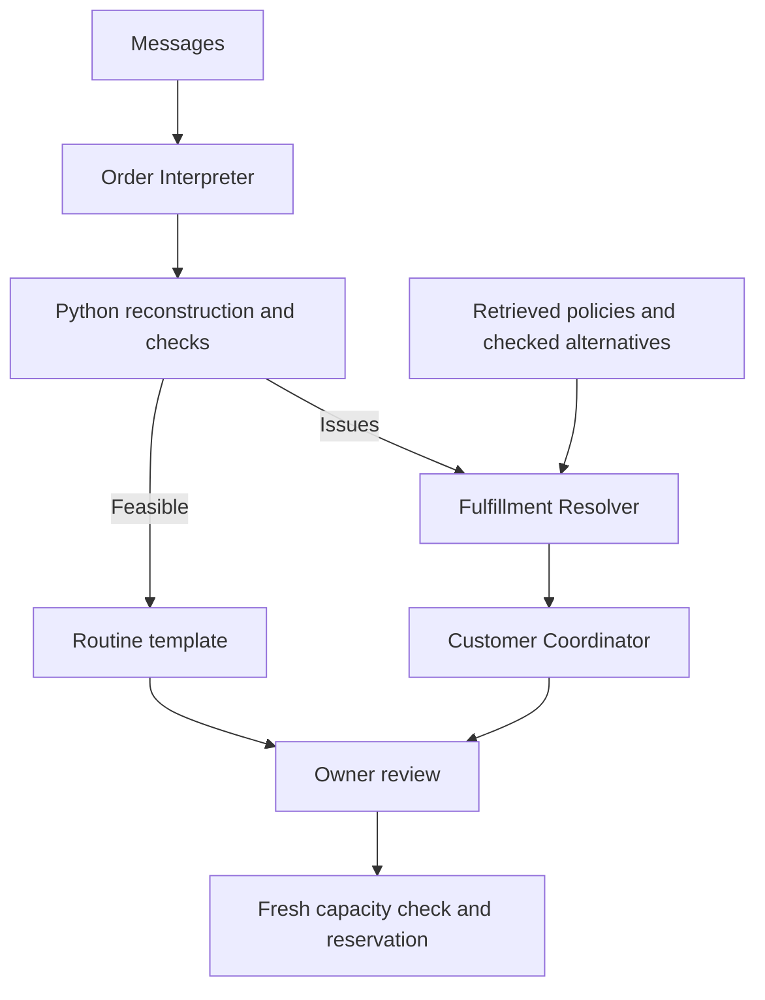

# Chat2Order

**Customers send messages. Chat2Order makes the next step clear.**

A presentation-ready Streamlit app for a small bakery. Three CrewAI agents
interpret order changes, resolve exceptions using checked capacity and retrieved
policies, and prepare customer response drafts. Python maintains the order state
and approval ledger. Groq is the only live LLM provider.

## Deploy from GitHub to Streamlit — no local development

1. Extract the ZIP. Create a GitHub repository and upload **the contents of the
   `chat2order/` folder**, including the `.streamlit/` and `.devcontainer/` folders.
   `app.py` and `requirements.txt` should be at the repository root.
2. At https://share.streamlit.io/ create an app from that repository, select your
   branch, and set the entry point to **`app.py`**.
3. In Advanced settings choose **Python 3.12**. Dependencies are pinned for
   Linux / Python 3.12, matching Streamlit Community Cloud and the supplied
   Codespaces configuration.
4. Deploy. It opens with synthetic bakery data in **Offline demo** mode.
   No API key is needed and no model request happens on startup.
5. For live agents, add the following in the app's **Settings → Secrets**:

   ```toml
   GROQ_API_KEY = "your-real-key"
   GROQ_MODEL = "openai/gpt-oss-20b"
   MAX_SESSION_CALLS = "12"
   # Optional on a publicly shared demo:
   # LIVE_AI_ACCESS_CODE = "your-access-code"
   ```

6. Select **Live AI**, open **Inbox**, and click **Process messages**.

Do not upload a real `.streamlit/secrets.toml` or `.env` to GitHub. The supplied
example files contain no credentials. Use the deployment secrets panel.

### If you want to edit in the browser

In GitHub choose **Code → Codespaces → Create codespace**. The supplied dev
container installs the requirements. Run:

```bash
streamlit run app.py --server.address 0.0.0.0 --server.port 8501
```

Open the forwarded port 8501. Commit changes to GitHub; Streamlit redeploys from
the repository. For live use in Codespaces, set `GROQ_API_KEY` as an environment
variable / Codespaces secret, or create an ignored `.streamlit/secrets.toml`
inside that cloud workspace. `.env.example` is documentation; `.env` is not
automatically loaded by this application.

## Two-minute hackathon story

1. **Overview:** the bakery has five conversations. Ayesha changed her request
   from 12 chocolate cupcakes to 6. Bilal wants 4 more, but daily chocolate
   capacity is 8. Hina has omitted her pickup time. Dani is ready for review;
   Zain has cancelled an unapproved request.
2. **Order desk:** inspect an attention card. Show the exact source messages,
   the numerical capacity issue, an available alternative, and a response draft.
   Both competing requests are flagged; the owner makes the allocation decision.
3. **Overview → Load customer answers:** the synthetic story adds Bilal's
   agreement to vanilla and Hina's pickup time. It reruns the same CrewAI Flow
   offline. The capacity conflict disappears.
4. **Order desk:** review and approve an order. Python rechecks current capacity
   and records a reservation. Show the updated approved value and order status.
5. **Agent studio:** show the three roles, structured events, retrieved policy
   evidence, request usage, and the owner decision trail.

Offline mode is explicitly labeled: it uses a narrow, deterministic parser and
fixture responses through real CrewAI agents. It is not live AI reasoning.
Use Live AI to demonstrate natural-language interpretation with Groq.

## Conversation input

```text
[Ayesha]
2026-09-30 10:00 | customer | I'd like 12 chocolate cupcakes for 2026-10-03 at 16:00, pickup please.
2026-09-30 10:03 | customer | Actually, make that 6.

[Bilal]
2026-09-30 10:12 | customer | Can I get 4 chocolate cupcakes for 2026-10-03 at 16:00, pickup please?
```

Use `[Customer name]` headers and `timestamp | customer or seller | text` lines.
Customer names identify conversations; use distinct labels for different people
with the same name. The MVP supports **one active, single-product pickup order
per conversation**, up to 25 unique messages / 18,000 characters per batch.
Separate multiple products or simultaneous orders into different conversations.
The built-in demo uses dates relative to the current day. Edit the dates in the
static CSV template before testing it later.

The offline parser supports explicit quantities, ISO dates, 24-hour times,
simple quantity changes, and cancellations. Unknown natural language is flagged
for review. Live AI can interpret broader language, but ambiguous information
still requires clarification.

## Architecture



- **Messages** retain original evidence and stable IDs.
- **Events** represent create, update, clarify, cancel, or ignore actions.
- **Proposed orders** are rebuilt from chronological events, so reprocessing
  does not add quantities or create duplicate reservations.
- **Approved reservations** remain separate. A change or cancellation preserves
  the old reservation until the owner records the decision.
- **Capacity** is a simple per-product, per-day limit. It is not ingredient
  inventory, a delivery scheduler, or an optimization engine.
- **RAG** is transparent lexical retrieval over labeled policy sections.
  Structured configuration, rather than an LLM interpretation of policy prose,
  enforces pickup hours, lead time, and capacity. Keep policy prose consistent
  with those settings.

### Actual resource controls

- At most **3 outbound Groq requests per run**, counted immediately before the
  SDK request. Provider errors count as attempts.
- Groq SDK `max_retries=0`; provider errors are wrapped into non-retryable
  application errors. CrewAI agents use `max_iter=1` and `max_retry_limit=0`.
- No manager agent, planning agent, delegation, model tool loops, embeddings,
  or implicit OpenAI calls. CrewAI and OpenTelemetry telemetry are disabled.
- A custom CrewAI `BaseLLM` adapter calls Groq directly, validates strict JSON
  output, and returns a Pydantic result. LiteLLM is unnecessary for this adapter.
- Straightforward orders use the Interpreter plus a Python response template.
  Resolver and Coordinator run only when operational issues exist.
- Validated stage results are cached **inside the current browser session**.
  Configuration, evidence, and reservation changes affect cache keys.
- Widget interactions do not launch LLM processing. The owner must click
  **Process messages** in Live AI mode.
- The session request limit is 12 by default and configurable in secrets. It is
  a convenience limit, **not** an account-wide or durable daily quota. A browser
  reload resets it. Use Groq account limits for wider spending controls.

### State and intended scope

This is a **single-owner hackathon MVP**. Streamlit Session State is temporary
and is reset on browser reload. Export/import a workspace JSON to preserve a
demo. A backup includes customer messages, orders, approvals, and the audit
trail; it does not contain the API key or agent cache. Do not put customer
backups in a public repository.

For real multi-user operation, replace session state with persistent storage and
perform approvals inside database transactions. A local SQLite file on a cloud
app is not presented here as a durable production store.

The app never sends messages, collects payments, or connects directly to
WhatsApp. Response drafts require review. JSON schema compliance and valid
source references do not prove that an LLM interpreted every message correctly.
The owner can edit proposed details after reviewing evidence. A new analysis
rebuilds proposals from messages; approved reservations remain separate.

## Project structure

| Path | Purpose |
| --- | --- |
| `app.py` | Streamlit screens, approvals, editing, and exports |
| `assets/styles.css` | Responsive visual design |
| `chat2order/models.py` | Typed messages, events, orders, and agent schemas |
| `chat2order/agents.py` | Three agents, bounded Groq bridge, and request counter |
| `chat2order/workflow.py` | CrewAI Flow and conditional handoffs |
| `chat2order/rules.py` | Reconstruction, arithmetic, capacity, and reservations |
| `chat2order/retrieval.py` | Policy retrieval |
| `chat2order/demo.py` | Deterministic offline adapters |
| `chat2order/data.py` | Sample data, import, and export |
| `demo_data/` | Synthetic bakery configuration and CSV template |
| `.streamlit/` | Theme and secrets example |
| `.devcontainer/` | Browser-only Codespaces configuration |
| `requirements.lock.txt` | Resolved Python 3.12/Linux dependency set |
| `scripts/smoke_check.py` | Small offline verification; never uses Groq |
| `DEPENDENCIES.md` | 2026 version verification and primary references |

## Limited verification

No paid LLM calls are needed to run the provided smoke check:

```bash
python scripts/smoke_check.py
```

The build verification covers dependency resolution/installation, Python
compilation, a small offline workflow check, and a small Streamlit UI smoke
check. The live Groq path has not been exercised against a real API key.
No automatic CI workflow or live-LLM test is included.

### Troubleshooting

- **Dependency installation fails:** ensure Python 3.12 was selected and all
  files were uploaded. `requirements.txt` needs `requirements.lock.txt` beside it.
  CrewAI's base package has substantial transitive dependencies; allow the
  first cloud installation to complete.
- **No live processing:** add `GROQ_API_KEY`, select Live AI, check the optional
  access code, and click Process messages. Startup stays offline by design.
- **HTTP 429 / timeout:** previous results stay intact. There is no automatic
  retry. Wait or reduce the batch, then retry explicitly.
- **Model unavailable:** check the model ID in Groq's current model catalog.
  The supplied adapter uses strict JSON schemas and low reasoning effort; it
  is configured for `openai/gpt-oss-20b` or `openai/gpt-oss-120b`.
- **Capacity conflict:** inspect other approved orders and pending requests.
  The owner can approve one competing request if its individual fresh check
  passes. Remaining requests are checked against the newly reserved capacity.
- **Date rejected:** pickup must satisfy the configured lead time, opening
  hours, and business timezone. The app will not fabricate missing dates.
